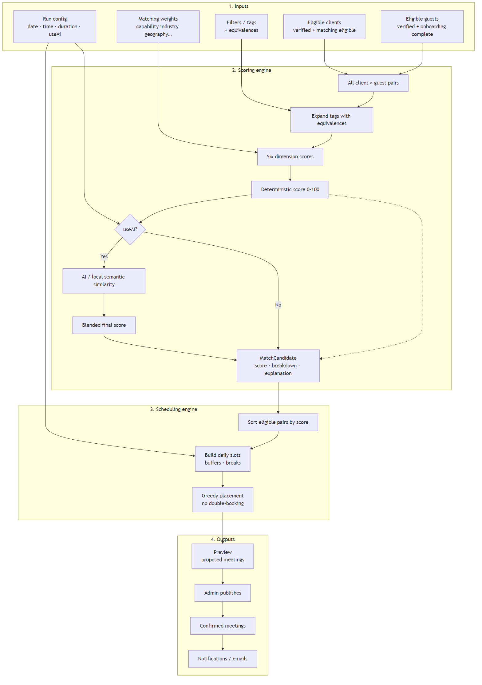
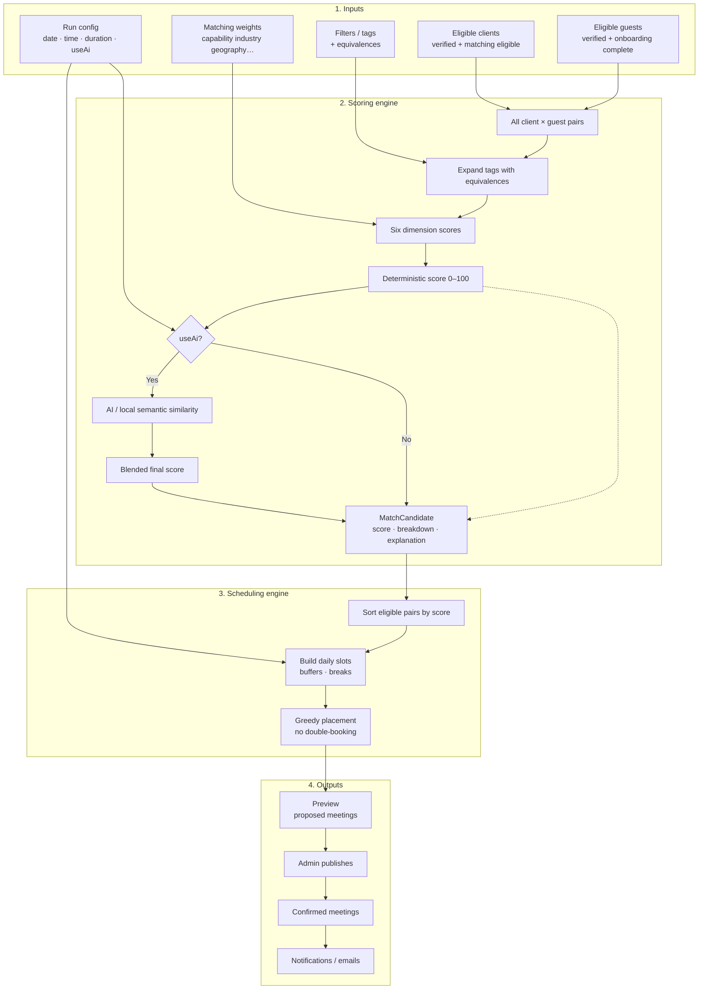
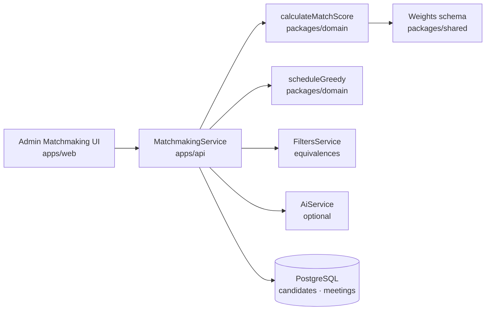

# Matchmaking Architecture

| | |
| --- | --- |
| **Document** | Matchmaking architecture diagram |
| **Product** | Ethara Event Matchmaking |
| **Audience** | Clients, product owners, developers |
| **Related** | [System flows](./SYSTEM_FLOWS.md) · [Architecture](./ARCHITECTURE.md) |

---

## Overview

Matchmaking has four layers:

1. **Inputs** — who can be matched and under which rules  
2. **Scoring** — how strong each client–guest fit is (0–100)  
3. **Scheduling** — when those pairs meet  
4. **Outputs** — candidates, draft meetings, then published confirmed meetings  

Deterministic tag scoring always runs. **AI is optional** and only adjusts the final score.

---

## Architecture diagram



*Source: [`matchmaking-architecture.mmd`](./matchmaking-architecture.mmd) · PNG: [`matchmaking-architecture.png`](./matchmaking-architecture.png)*

<details>
<summary>Mermaid source (editable)</summary>



</details>

---

## Component view (code)



---

## Scoring dimensions

| Dimension | Default weight | Compares |
| --- | --- | --- |
| Capability | 30% | Client needs ↔ guest capabilities |
| Industry | 20% | Industry alignment |
| Requirements | 20% | Needs ↔ guest categories / capabilities |
| Geography | 10% | Venues / locations |
| Commercial | 10% | Partnership tags |
| Preferences | 10% | Preferred categories ↔ guest categories |

Optional AI blend (default ~30% of final score when enabled):

```text
finalScore = (1 − blendWeight) × tagScore + blendWeight × aiScore
```

---

## Data flow summary

| Step | Input | Output |
| --- | --- | --- |
| 1 | Approved profiles + filters | Pair list |
| 2 | Tags + weights (+ AI text) | Scored candidates |
| 3 | Candidates + time window | Proposed meetings in slots |
| 4 | Admin publish | Confirmed meetings + notifications |

---

## How to use / regenerate

- **Share with client:** attach or embed `docs/matchmaking-architecture.png`.
- **Regenerate PNG** after editing the `.mmd` file:

```bash
npx @mermaid-js/mermaid-cli -i docs/matchmaking-architecture.mmd -o docs/matchmaking-architecture.png -b white -s 2
```
