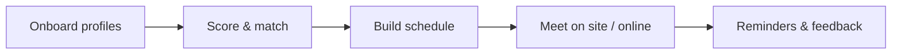
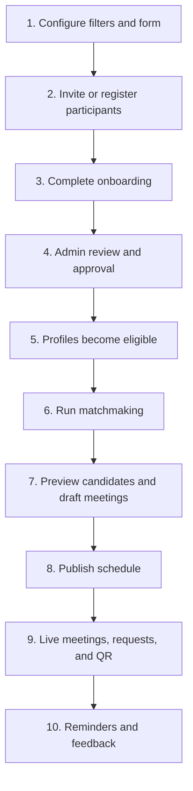
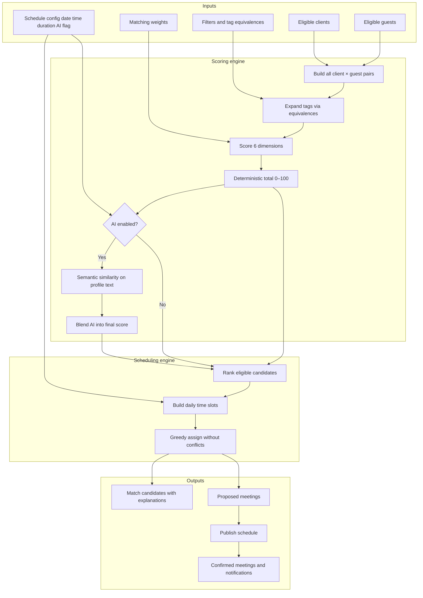
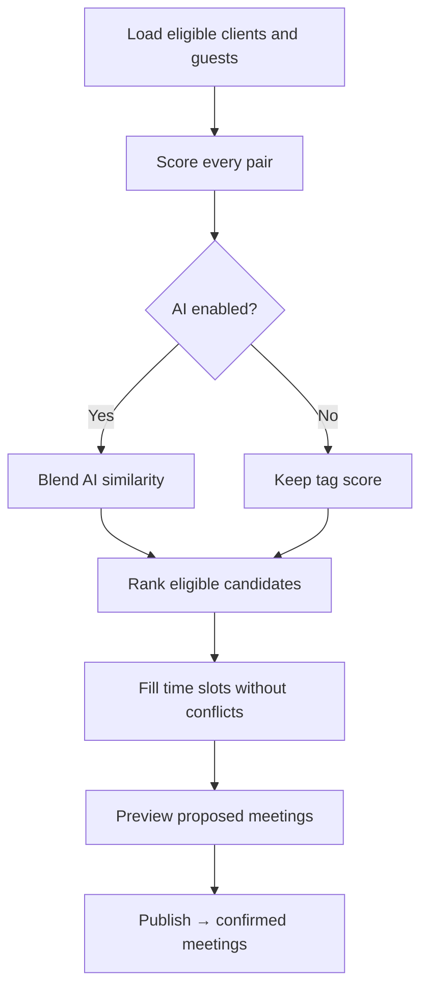
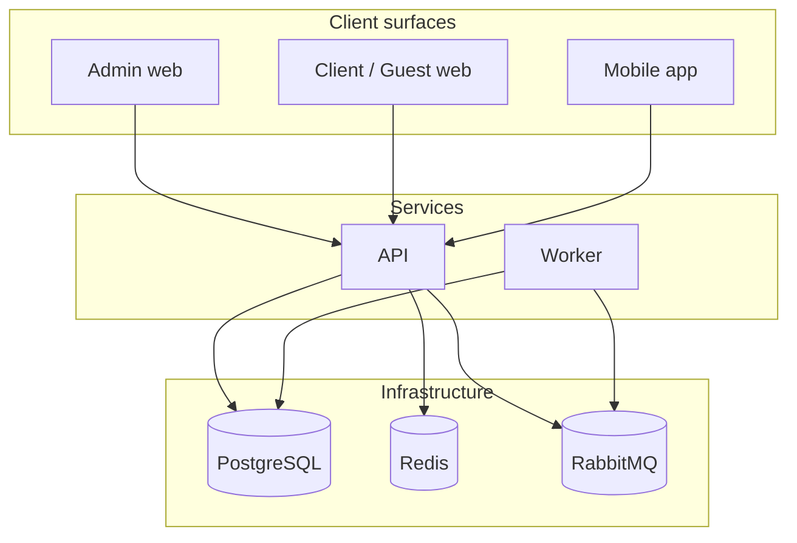

# Ethara Event Matchmaking Platform

## Product & Technical Documentation

| | |
| --- | --- |
| **Document title** | System flows and matchmaking guide |
| **Product** | Ethara Event Matchmaking |
| **Audience** | Client stakeholders, product owners, and developers |
| **Version** | 1.0 |
| **Status** | Current |
| **Related documents** | [Architecture](./ARCHITECTURE.md) · [Deployment](./DEPLOYMENT.md) · [Runbooks](./RUNBOOKS.md) |

---

## Table of contents

1. [Purpose of this document](#1-purpose-of-this-document)
2. [What the platform does](#2-what-the-platform-does)
3. [Who uses the platform](#3-who-uses-the-platform)
4. [Glossary](#4-glossary)
5. [End-to-end business flow](#5-end-to-end-business-flow)
6. [Matchmaking explained](#6-matchmaking-explained)
7. [Operator guide (admin)](#7-operator-guide-admin)
8. [Participant guide (client & guest)](#8-participant-guide-client--guest)
9. [Technical overview for developers](#9-technical-overview-for-developers)
10. [API & code reference](#10-api--code-reference)
11. [Demo walkthrough](#11-demo-walkthrough)

---

## 1. Purpose of this document

This document explains how the Ethara Event Matchmaking platform works so that:

- **Clients and stakeholders** understand the business process, value, and how meetings are created.
- **Operators (admins)** know the exact steps to configure an event, onboard participants, run matching, and publish schedules.
- **Developers** understand architecture, data mapping, scoring logic, and where the code lives.

It describes the product as implemented today.

---

## 2. What the platform does

The platform helps Ethara-style events connect **clients** (organizations seeking partnerships or services) with **guests** (partners, suppliers, rights-holders, talent, and service providers).

It supports:

1. **Onboarding** — one Ethara-aligned profile form for both clients and guests.
2. **Matching** — scored suggestions based on event categories, venues, services, and commercial focus (optional AI boost).
3. **Scheduling** — automatic meeting slots without double-booking.
4. **Live networking** — meeting requests, QR exchange, and meet-now confirmations.
5. **Follow-through** — reminders, feedback, and admin reporting.



---

## 3. Who uses the platform

| Role | Description | Primary access |
| --- | --- | --- |
| **Admin / Operator** | Configures filters, forms, invites participants, runs matchmaking, publishes meetings | Web admin console |
| **Client** | Organization looking for relevant guests to meet | Web client portal and mobile app |
| **Guest** | Partner or provider available for meetings | Web guest workspace and mobile app |
| **Operations** | Adjusts meetings, overrides, jobs, and day-of logistics | Admin console |

### Naming used in the product

| Shown in the UI | Meaning in the system |
| --- | --- |
| Client | Company organization |
| Guest | Vendor organization |
| Ethara onboarding form | Single shared profile form for clients and guests |

---

## 4. Glossary

| Term | Meaning |
| --- | --- |
| **Filter / tag** | A controlled value such as “Concerts”, “Motorsport”, or “Venue management” |
| **Equivalence** | A link between related tags (for example Sports ↔ Motorsport) so they count as related in scoring |
| **Onboarding form** | The Ethara profile questionnaire used for matching |
| **Eligible profile** | Approved participant included in matchmaking |
| **Match score** | Number from 0–100 explaining how well a client and guest fit |
| **Matchmaking run** | One admin job that scores pairs and drafts a day’s schedule |
| **Proposed meeting** | Draft meeting created by a run, not yet published |
| **Confirmed meeting** | Published meeting visible to both parties |
| **AI boost** | Optional semantic re-ranking on top of tag-based scores |
| **Meet now** | Short-window confirmation for an immediate on-site meeting |
| **QR exchange** | Scan or open a participant QR to identify and connect |

---

## 5. End-to-end business flow

The platform follows ten stages from setup to post-meeting follow-up.



### Stage 1 — Configure filters and form

**Owner:** Admin

1. Define Ethara-aligned tags (categories, venues, services, commercial focus).
2. Optionally link related tags (equivalences).
3. Publish the single **Ethara onboarding form**.
4. Point public registration at that form.

Outcome: the event has a shared vocabulary for matching.

### Stage 2 — Invite or register participants

**Owner:** Admin and/or participants

**Path A — Admin invite**

1. Admin invites a client or guest by email.
2. Participant receives an invitation.
3. Participant registers and joins their organization.

**Path B — Public event registration**

1. Participant opens the public registration page.
2. Verifies identity (OTP).
3. Chooses client or guest role and submits the onboarding form.

Outcome: organizations and users exist in the system.

### Stage 3 — Complete onboarding

**Owner:** Client or guest

Participants answer:

- Organization summary and industry
- Focus Ethara events / work
- Event and work categories
- Preferred venues and locations
- Services and capabilities
- Commercial / partnership type
- Optional partnership goal

Outcome: structured profile data ready for scoring.

### Stage 4 — Admin review and approval

**Owner:** Admin

1. Review the submission.
2. Approve, reject, or request corrections.
3. On approval, the organization is marked verified and matching-eligible.

Outcome: only quality-checked profiles enter matchmaking.

### Stage 5 — Profiles become eligible

A profile is included in matchmaking when it is:

- Active
- Verified / approved
- Marked matching-eligible
- For guests: onboarding complete

### Stage 6 — Run matchmaking

**Owner:** Admin

1. Choose schedule date, time window, meeting length, and timezone.
2. Optionally enable **Use AI to boost matching**.
3. Start the run.

The system scores every eligible client–guest pair, then places the best pairs into available time slots.

### Stage 7 — Preview

**Owner:** Admin

Review:

- Top candidate scores and explanations
- Draft (proposed) meetings for the day

Adjust manually if needed (manual assign or ad-hoc meeting).

### Stage 8 — Publish schedule

**Owner:** Admin

Publishing:

- Confirms the schedule
- Sets meetings to **Confirmed**
- Notifies participants

### Stage 9 — Live networking

**Owners:** Clients and guests

During the event, participants can:

- View their meetings
- Send or accept meeting requests
- Use QR codes to identify each other
- Start a **Meet now** confirmation for immediate meetings

### Stage 10 — Reminders and feedback

- Both parties can receive a reminder about 30 minutes before a meeting.
- Feedback after meetings supports follow-up and reporting.

---

## 6. Matchmaking explained

### 6.0 Matchmaking architecture



**Layers in short**

| Layer | Responsibility |
| --- | --- |
| Inputs | Eligible profiles, Ethara tags/equivalences, weights, run settings |
| Scoring | Pair every client with every guest; tag overlap (+ optional AI blend) |
| Scheduling | Place best pairs into free slots without double-booking |
| Outputs | Candidates, proposed meetings → publish → confirmed + notify |

**Image:** [matchmaking-architecture.png](./matchmaking-architecture.png)  
**Standalone page:** [MATCHMAKING_ARCHITECTURE.md](./MATCHMAKING_ARCHITECTURE.md)

### 6.1 Business view

Matchmaking answers three questions:

1. **Who should meet whom?** — based on shared Ethara interests and capabilities  
2. **How strong is the fit?** — a transparent 0–100 score with an explanation  
3. **When should they meet?** — automatic placement into free time slots  

Matching is primarily **rules and tags**. AI is optional and only adjusts ranking; it does not replace the deterministic score.

### 6.2 What data is compared

| Profile area | Client meaning | Guest meaning |
| --- | --- | --- |
| Categories | Preferred Ethara event / work types | Event / work types they represent |
| Capabilities / services | What they need | What they offer |
| Venues / locations | Where they want to engage | Where they operate |
| Commercial tags | Partnership style they seek | Partnership style they provide |
| Industry | Sector | Sector |
| About / focus text | Used when AI boost is enabled | Used when AI boost is enabled |

Examples of Ethara-aligned tags:

- Categories: Concerts, Motorsport, Combat sports, Festivals, Heritage, Public art  
- Services: World-class events, Content & creation, Venue management, Sponsorship & sales, Technology & innovation  
- Venues: Etihad Arena, Yas Marina Circuit, Coca-Cola Arena, Abu Dhabi, Dubai  

### 6.3 How the score is calculated

Each client–guest pair receives a weighted score. Default weights:

| Dimension | Weight | Plain-language meaning |
| --- | --- | --- |
| Capability | 30% | Do the guest’s skills match what the client needs? |
| Industry | 20% | Are they in related industries? |
| Requirements | 20% | Do needs align with guest categories or capabilities? |
| Geography | 10% | Do preferred venues / locations overlap? |
| Commercial | 10% | Do partnership types align? |
| Preferences | 10% | Do preferred event categories match? |

**Total score** = weighted sum of dimension scores (each dimension is 0–100).

Related tags configured by admin (equivalences) expand matches. For example, a client interested in **Sports** can still score well against a guest tagged **Motorsport**.

### 6.4 Optional AI boost

When the admin enables AI:

1. The system builds a short text profile from about, focus events, and tags.
2. It measures how similar the two narratives are.
3. It blends that similarity into the final score (default blend about 30% AI / 70% tag score).

If no AI provider is configured, a local text-similarity fallback is used so demos still work.

### 6.5 How meetings are scheduled

After scoring:

1. Eligible pairs above a minimum score are ranked highest first.
2. The scheduler fills the day greedily:
   - One meeting per client–guest pair
   - No overlapping meetings for the same person
   - Respect meeting length, buffers, and breaks
   - Prefer spacing between a guest’s consecutive meetings
3. Draft meetings are created as **Proposed**.
4. After publish, they become **Confirmed**.



### 6.6 What operators can override

| Action | When to use |
| --- | --- |
| Tag equivalences | Related Ethara categories should cross-match |
| Manual assign | Force a strategic meeting into a slot |
| Create manual meeting | Add a meeting outside the automated run |
| Regenerate day | Rebuild the schedule after cleanup (replaces existing meetings for that date) |
| Edit / cancel meeting | Day-of changes |

---

## 7. Operator guide (admin)

### 7.1 Recommended setup order

1. **Filters** — confirm Ethara tags and equivalences  
2. **Forms** — confirm only **Ethara onboarding form** is published  
3. **Places** — add rooms / tables if meetings are in person  
4. **Settings** — meeting window dates, duration, AI flags if needed  
5. **Clients / Guests** — invite or import participants  
6. **Review submissions** — approve eligible profiles  
7. **Matchmaking** — run, preview, publish  
8. **Meetings** — monitor calendar and day-of changes  

### 7.2 Admin console map

| Menu | Purpose |
| --- | --- |
| Overview | Event snapshot |
| Client | Invite and manage clients |
| Guests | Invite and manage guests |
| Forms | Onboarding form builder and directory |
| Filters | Tags and dimensions |
| Matchmaking | Run matching, AI option, tag mappings |
| Meetings | Calendar and meeting management |
| Places | Physical locations / capacity |
| Recommendations | Peer recommendation cache |
| Notifications / Jobs | Delivery and background work |
| Integrations / Settings | AI, email, booking windows |

### 7.3 Running a matchmaking day

1. Open **Matchmaking**.
2. Set date, start time, end time, and meeting length.
3. Optionally enable **Use AI to boost matching**.
4. If meetings already exist that day, tick **Replace existing meetings** to regenerate.
5. Click **Run matchmaking**.
6. Review candidate scores and explanations.
7. Click **Publish schedule** when ready.
8. Confirm results under **Meetings**.

---

## 8. Participant guide (client & guest)

### 8.1 First-time journey

1. Receive invite or open public registration.  
2. Create account / verify OTP.  
3. Complete the Ethara onboarding form.  
4. Wait for admin approval (if required).  
5. Explore recommendations and meetings in the portal or mobile app.

### 8.2 Where to go

| Need | Client | Guest |
| --- | --- | --- |
| Home overview | Client portal home | Guest workspace home |
| Complete profile | Onboarding | Forms |
| Suggested people | Home / Discover (mobile) | Home / Discover (mobile) |
| Meeting requests | Requests | Requests |
| Agenda | Meetings | Meetings |
| QR identity | QR | QR |

### 8.3 During the event

- Arrive with meetings already confirmed where possible.
- Use **Requests** for additional introductions.
- Use **QR** to identify a counterpart and optionally start **Meet now**.
- Expect a reminder before upcoming meetings.

---

## 9. Technical overview for developers

### 9.1 Architecture

| Component | Location | Responsibility |
| --- | --- | --- |
| Web application | `apps/web` | Admin, client portal, guest workspace, public pages |
| API | `apps/api` | REST API, matchmaking orchestration, auth, forms |
| Worker | `apps/worker` | Async invitations, notifications, corrections |
| Mobile | `mobile/` | Flutter app (home, discover, requests, meetings, QR) |
| Domain package | `packages/domain` | Scoring, eligibility, greedy scheduler |
| Shared package | `packages/shared` | Schemas, weights, permissions, templates |
| Database | `prisma/schema.prisma` | PostgreSQL schema (source of truth) |

Supporting infrastructure: PostgreSQL, Redis, RabbitMQ.

**Design principle:** Deterministic matching works without AI. AI is enrichment only.



### 9.2 Profile sync from the onboarding form

Form code: `ETHARA_ONBOARDING`

| Form field key | Client storage | Guest storage |
| --- | --- | --- |
| `categories` | `Company.preferredCategories` | `Vendor.categories` |
| `capabilities` | `Company.requiredCapabilities` | `Vendor.capabilities` |
| `regions` | `normalizedProfile.regions` | `Vendor.operatingRegions` |
| `commercialTags` | `commercialPrefs.tags` | `commercialPrefs.tags` |
| `industry` | `Organization.industry` | `Organization.industry` |
| about / focus events | `normalizedProfile` | `normalizedProfile` |

Sync entry point: `FormsService.normalizeProfile` in `apps/api/src/forms/forms.service.ts`.

### 9.3 Matchmaking pipeline (technical)

1. `POST /matchmaking/runs` validates `scheduleConfigSchema` (includes `useAi`).
2. `MatchmakingService.processRun`:
   - Loads eligible clients and guests
   - Loads tag equivalences
   - Scores each pair via `calculateMatchScore`
   - Optionally blends AI semantic similarity
   - Writes `MatchCandidate` rows
   - Runs `buildDailySlots` + `scheduleGreedy`
   - Creates proposed `Meeting` records
3. `POST /matchmaking/schedules/:id/publish` confirms meetings and triggers notifications.

Default weights (must sum to 1.0):

```
capability 0.30
industry 0.20
requirements 0.20
geography 0.10
commercial 0.10
mutualPreferences 0.10
```

AI blend (when enabled):

```
final = (1 - blendWeight) * deterministicScore + blendWeight * aiScore
```

Default `blendWeight` ≈ `0.3` (`ai.matchmakingBlendWeight`).

### 9.4 Important behavioural notes

- Capability fit primarily affects **score**, not a hard block, when no mandatory capabilities are configured on the run.
- Soft score floor for scheduling uses `min(rule.minScore, 20)`.
- Regenerating a date requires `forceRegenerate` if meetings already exist.
- Public event registration creates a submission; full tag sync for matching is ensured when submissions are processed through the forms profile-normalization path (approve / submit flows used by operators).

---

## 10. API & code reference

### 10.1 Primary APIs

| Area | Endpoints (representative) |
| --- | --- |
| Invites | `POST /organizations/companies/invite`, `POST /organizations/vendors/invite` |
| Registration | `GET/POST /registration/event/*` |
| Forms | `GET /forms`, `POST /forms/submissions`, onboarding and review endpoints |
| Filters | `/filters/dimensions`, `/filters/mappings` |
| Matchmaking | `POST /matchmaking/runs`, `GET /matchmaking/runs/:id`, `POST /matchmaking/schedules/:id/publish` |
| Meetings | `/matchmaking/meetings`, `/meetings` |
| Requests | `/meeting-requests` |
| QR | `GET /qr/me`, `POST /qr/resolve` |
| Recommendations | `GET /recommendations` |

### 10.2 Key source files

| Concern | Path |
| --- | --- |
| Scoring algorithm | `packages/domain/src/scoring.ts` |
| Eligibility rules | `packages/domain/src/eligibility.ts` |
| Scheduler | `packages/domain/src/scheduler.ts` |
| Schedule / AI config schema | `packages/shared/src/matching.ts` |
| Matchmaking service | `apps/api/src/matchmaking/matchmaking.service.ts` |
| Profile normalization | `apps/api/src/forms/forms.service.ts` |
| Filters / equivalences | `apps/api/src/filters/filters.service.ts` |
| Recommendations | `apps/api/src/meetings/recommendations.service.ts` |
| Meeting requests | `apps/api/src/meetings/meeting-requests.service.ts` |
| QR | `apps/api/src/meetings/qr.service.ts` |
| Reminders | `apps/api/src/meetings/meeting-reminder.service.ts` |
| Ethara demo seed | `prisma/seed-ethara-demo.ts` |

### 10.3 Web routes

| Audience | Routes |
| --- | --- |
| Admin | `/admin`, `/admin/companies`, `/admin/vendors`, `/admin/forms`, `/admin/filters`, `/admin/matchmaking`, `/admin/meetings`, `/admin/places`, `/admin/settings` |
| Client | `/portal`, `/portal/onboarding`, `/portal/requests`, `/portal/meetings`, `/portal/qr` |
| Guest | `/vendor`, `/vendor/forms`, `/vendor/requests`, `/vendor/meetings`, `/vendor/qr` |
| Public | `/login`, `/register`, `/register/event`, `/qr/[code]` |

---

## 11. Demo walkthrough

Use this checklist when presenting the product.

1. Seed demo data: `npm run db:seed:ethara`
2. Confirm **Forms** shows **Ethara onboarding form** only.
3. Confirm **Filters** include Ethara categories, services, and venues.
4. Sign in as a seeded client and guest; profiles should already be eligible.
5. As admin, open **Matchmaking**, choose a date, optionally enable AI, and run.
6. Review scores and explanations, then publish.
7. Show **Meetings** calendar and participant agendas.
8. Optional live demo: meeting request, QR scan, or meet-now.

---

## Document control

| Item | Value |
| --- | --- |
| Maintained in | `docs/SYSTEM_FLOWS.md` |
| Owner | Engineering / product |
| Update when | Matching rules, onboarding form, or major participant flows change |

For deployment and environment setup, see [DEPLOYMENT.md](./DEPLOYMENT.md).  
For architecture principles, see [ARCHITECTURE.md](./ARCHITECTURE.md).
